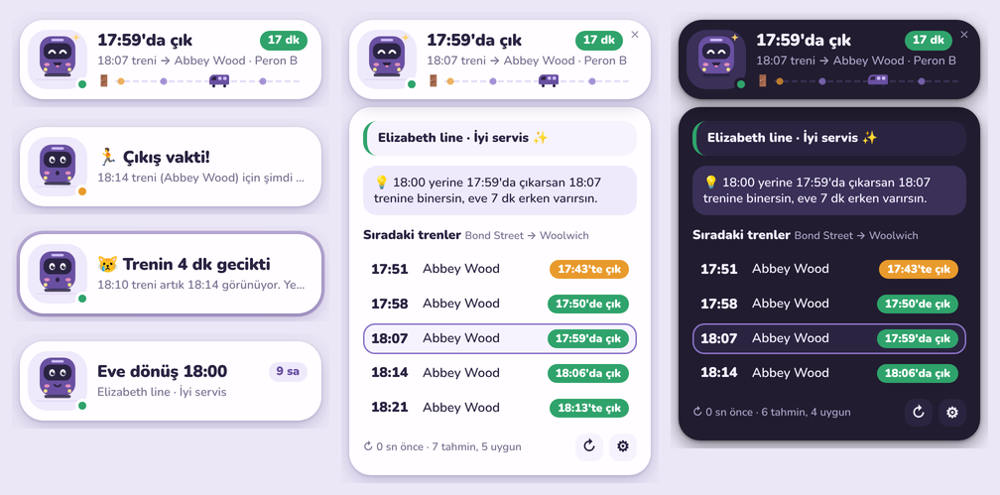

# Lizzie 💜🚆

Elizabeth line ile eve dönüşünü hatırlatan, ekranın köşesinde duran minicik bir Windows widget'ı.

"18:00'de çıkıyorum ama kaçta çıksam mantıklı?" sorusunu her gün senin yerine o düşünür.
Canlı TfL verisine bakar, masandan perona yürüme süreni hesaba katar ve
**"17:59'da çık → 18:07 treni"** gibi tek bir cümle söyler. Rötar, iptal ya da hat
sorunu olursa da hem widget'ta hem Windows bildirimiyle haber verir.



## Ne yapar?

- **Kaçta çıkmalıyım?** Normal çıkış saatinin (ör. 18:00) en fazla 3 dk öncesinden
  başlayarak yetişebileceğin ilk treni seçer ve masadan kalkış saatini söyler.
- **18:00'de çıksam ne olur?** Panelde açıklar: "18:00 yerine 17:59'da çıkarsan 18:07
  trenine binersin, eve 7 dk erken varırsın" ya da "18:00'de çıkarsan perona 18:08 gibi
  varıp 4 dk beklersin; 18:04'te çık".
- **Neredeysen oradan:** Windows konum servisiyle sana en yakın Elizabeth line durağını
  bulur, yürüme süresini mesafeden hesaplar (sokak payı + perona iniş). Bugün başka bir
  ofisteysen oradan, evdeysen sabah yönünde (eve → işe) hesaplar. Konum kapalı ya da
  bulanıksa ayarlardaki iş durağını ve yürüme süreni kullanır, panelde de nedenini söyler.
- **Ev ve iş yeri:** Ayarlarda posta kodu, adres ya da durak yazıp Enter'a bas (TfL'de
  arar) ya da oradayken 📍'ya bas. En yakın Elizabeth line durakları kendiliğinden seçilir
  (istersen Gelişmiş'ten elle sabitlersin), süreler kapıdan kapıya hesaplanır.
- **Adım adım tarif:** Panelde "🚶 6 dk yürü → Bond Street · 🟣 Elizabeth line, Abbey Wood
  yönü: Bin 18:07 Bond Street → İn 18:26 Woolwich, 6 durak · 🚶 5 dk yürü → ev". B planı
  gerekiyorsa aktarmalarıyla birlikte o yolu gösterir ("Aktar: DLR …").
- **Elizabeth yoksa B planı:** Hat kapalıysa, eve giden tren görünmüyorsa ya da ciddi
  aksaklıkta başka yol belirgin erken vardırıyorsa, TfL rota planlayıcısından Elizabeth
  line'sız en erken varan yolu (Tube, DLR, Overground, tren, otobüs) bulur. Hap
  "17:55'te çık · 🔀 Jubilee → DLR · 18:36 varış" der, bir kez de bildirim gelir. Normal
  günlerde başka yol 5+ dk daha hızlıysa bunu panelde gösterir.
- **Lime / Voi e-bisiklet:** Aynı çıkış saati için e-bisikletle (TfL'nin bisiklet
  rotası, "hızlı" sürücü + 4 dk bisikleti bulma/park payı) ve trenle kapıdan kapıya
  süreyi kıyaslar. Hat sorunluysa hap ve bildirim "Lime/Voi ile eve ~31 dk" der. Ev
  adresini seçtiysen süre kapına kadar hesaplanır. Lime ve Voi, Londra'daki araçlarının canlı
  konumunu herkese açık yayınlamıyor. Lime'ın şehir akışı Londra için de açılırsa yakındaki
  Lime bisikletlerini de gösterir, açık değilse bu satır görünmez.
- **Doğru trenler:** Yalnızca senin durağında da duran trenleri sayar (Abbey Wood /
  Shenfield / Heathrow / Reading dallarını ayırt eder, erken biten trenleri eler).
- **Değişince söyler:** Hedef trenin saati 2+ dk kayarsa, tren listeden düşerse ya da
  Elizabeth line'da gecikme/kapanma olursa bildirir. Çıkmana 5 dk kala "toparlan",
  vakit gelince "şimdi çık" der.
- **Yer kaplamaz:** 264×72 px, en fazla 2 satırlık bir hap. Tıklayınca panel açılır, başka yere
  tıklayınca küçülür. Sürükleyip istediğin köşeye koyabilirsin, yerini hatırlar.
  Tepsi simgesinden gizleyip açabilirsin.
- **Sade bir yüz:** Lizzie'nin yüzü yalnızca göz ve ağızla konuşur: her şey yolundayken
  ^^ gülümser, "şimdi çık"ta ağzı açılır, aksaklıkta düz, ciddi sorunda üzgün, mesai
  dışında gözleri kapalıdır. Köşedeki nokta hattın durumu (yeşil / turuncu / kırmızı).

Zaman çizelgesi (panelde): soldaki 🚪 "şimdi çıkman gerek" anlamına gelir.
Trenler, onlara yetişmek için çıkman gereken ana göre dizilir ve zaman geçtikçe kapıya
yaklaşır. Minik mor vagon senin hedef trenin.

## Kurulum

1. Bu depodaki **Actions → Windows build** iş akışının son çalışmasından
   `Lizzie-windows` paketini indir (ya da sana gönderilen `Lizzie_x.y.z_x64-setup.exe`'yi kullan).
2. `Lizzie_…_x64-setup.exe`'yi çalıştır. İmzasız olduğu için Windows SmartScreen
   "Bilinmeyen yayımcı" diyebilir: **Ek bilgi → Yine de çalıştır**.
3. İlk açılışta ayarlar gelir: iş ve ev durağını, akşam (ve istersen sabah) çıkış
   saatini gir. **Windows açılınca başlat**'ı işaretle.
4. Konumun çalışması için Windows'ta **Ayarlar › Gizlilik ve güvenlik › Konum** altında
   konum servisleri ve "Masaüstü uygulamalarının konumuna erişmesine izin ver" açık olmalı.
   Windows ilk seferde Lizzie için izin sorabilir.

Windows 10/11 gerekir (WebView2 zaten yüklüdür). Kurulum kullanıcı klasörüne yapılır,
yönetici izni istemez.

## Veri ve gizlilik

Yalnızca TfL'nin herkese açık Unified API'sine (`api.tfl.gov.uk`) bağlanır:
`/Line/elizabeth/Arrivals`, `/Line/elizabeth/Status`, `/Line/elizabeth/StopPoints`,
`/Line/elizabeth/Route/Sequence`, `/Journey/JourneyResults` (B planı, bisiklet/tren süresi);
e-bisiklet açıksa Lime'ın açık GBFS akışını da dener (`data.lime.bike`). Mesai saatinde 30 sn'de bir, dışında 10 dk'da bir
yoklar. Konumun yalnızca bilgisayarında, en yakın durağı bulmak için kullanılır; hiçbir
yere gönderilmez. Ayarlar da bilgisayarında kalır. Anahtarsız çalışır; çok yoğun kullanımda
[TfL API portalından](https://api-portal.tfl.gov.uk) ücretsiz bir app key alıp
Ayarlar → Gelişmiş'e yazabilirsin.

## Geliştirme

```sh
npm install
npm test            # mantık testleri (node:test)
npm run dev         # Windows'ta canlı geliştirme
npm run build       # Windows'ta kurulum dosyası: src-tauri/target/release/bundle/nsis/
```

Linux'tan Windows için derleme (mingw-w64 ve NSIS kurulu olmalı):

```sh
rustup target add x86_64-pc-windows-gnu
npx tauri build --target x86_64-pc-windows-gnu
```

Arayüzün ekran görüntüleri sahte TfL verisiyle: `TZ=Europe/London node tests/preview.mjs shots/`
(Playwright gerekir).

| Dosya | Ne işe yarar |
| --- | --- |
| `src/logic.js` | Saf mantık: konuma göre yolculuk seçimi, tren süzme, "kaçta çık" planı, rötar takibi, Türkçe saat ekleri |
| `src/app.js` | Arayüz, TfL'yi yoklama, hatırlatmalar ve bildirimler |
| `src/face.js` | Lizzie'nin yüzü (SVG) ve ruh halleri |
| `src-tauri/src/main.rs` | Windows kabuğu: pencere, tepsi, konum, bildirim, otomatik başlatma |
